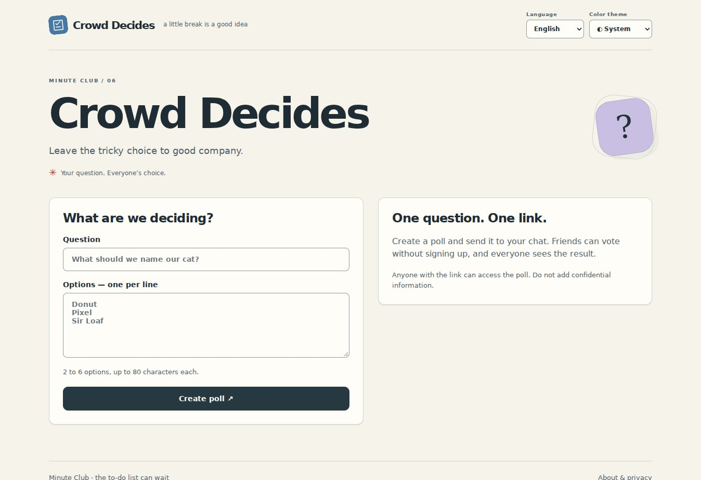

<div align="center">


# Crowd Decides

**Send a link. Settle the question.**

Create a quick poll and let your friends decide together.

**English** · [Русский](README.ru.md)

  

</div>

[Features](#features) · [Stack](#technology-stack) · [Quick start](#quick-start) · [License](LICENSE)



*Actual local application capture with an empty test database; this is not audience activity.*

## Features

- Two to six distinct choices
- Unguessable links for sharing
- Shared results and browser-local recent polls
- The creator can close voting from the same browser; results remain visible

**Try the flow: Ask → share → vote → decide.**

Documentation: English / Русский. App interface: English, Русский, selected from browser preferences or manually. System theme by default, with explicit light and dark modes. The system mode follows device changes; your choice is saved locally.

## Technology stack

| Layer | Implementation |
| --- | --- |
| Interface | HTML · CSS · JavaScript / native ES modules |
| Runtime | Node.js 24+ · SQLite |
| Development | JavaScript |
| Dependencies | No third-party browser libraries or remote fonts |

## Quick start

Requires Node.js 24+. No install or build step.

```sh
npm start
```

Open http://localhost:3000. The root opens this application; unrelated app routes and APIs are disabled. Data persists in `data/minute.sqlite`.

```sh
npm test
npm run check
```

## Deploy

Set `PUBLIC_ORIGIN` to the exact HTTPS origin, give the process a persistent `DATA_DIR`, and put an HTTPS reverse proxy in front. Example Dockerfile, Caddy config, environment file, and systemd unit are included. Each independent project needs its own port and data directory. `.env` is not loaded automatically: use exported variables or `node --env-file=.env server/index.mjs`. See [OPERATIONS.md](OPERATIONS.md) for backups, moderation, identity limitations, and storage details.

Polls have 2–6 distinct choices and unguessable share links. Everyone with the link can participate. Results are shared, recent poll history is browser-local. Anonymous browser voting is not identity verification.

---

[More by den9911](https://github.com/den9911) · [Report an issue](https://github.com/den9911/crowd-decides/issues) · [LICENSE](LICENSE)


## Recent improvements / Последние улучшения

Creators can open Create a similar poll to prepare an editable draft with only the title and options. Votes, closure and ownership secrets are not copied. A new poll is published only on explicit submission; the template endpoint checks the creator’s current session.

Создатель может подготовить похожий опрос: только заголовок и варианты, без голосов и закрытия. Новый опрос публикуется отдельным действием; права проверяются сервером по сессии.

Startup diagnostics / Проверка запуска: `node server/index.mjs --check` checks the local address, configuration and writable data location without creating a database or starting the API. To use another port: `--port 3005`. No tokens are printed. / База и сервер при проверке не создаются; секреты не выводятся.


## Session ownership — 14 November

The original signing key is preserved on restart. Empty, malformed or oversized key files now stop startup before SQLite opens. A missing key beside an existing database is not regenerated: restore the matching database/session-key backup. Creating a new key does not recover a lost browser cookie, and no endpoint grants ownership to a stranger. Explicit managed options.secret must remain identical on every start; automatic key rotation is not implemented.

Fresh initialization writes and syncs a private temporary key, then publishes it with a same-filesystem hard link without replacing an existing key. Concurrent initializers read the same complete key. Normal temporary files are cleaned. The data filesystem must support hard links; unsupported storage fails rather than silently changing identity. This is not a hardware power-loss or arbitrary-filesystem guarantee. Disk keys are exactly 64 lowercase hex bytes; managed secrets are bounded to 32–128 bytes. No secret values are logged. Backups contain sensitive signing material and must remain private.

При отсутствии или повреждении session-key восстановите исходный ключ из согласованной резервной копии. Удаление ключа не сбрасывает пароль и не возвращает потерянную cookie. Публичная информация об опросе не содержит owner secret. Сервер не восстанавливает права на основании ID опроса.

Creator access belongs to the original browser session, not the share link or the recent-polls list. Keep its cookies and site data. If that session is lost, the app explains the limitation; it cannot recover ownership. Viewing and voting in open polls remain available.

Poll creation now retries the same saved request after a lost response, keeping one poll. An unconfirmed Close action refreshes server state before offering another action. Keep the original browser session and its pending request; clients that omit `requestId` retain the legacy create behavior.
