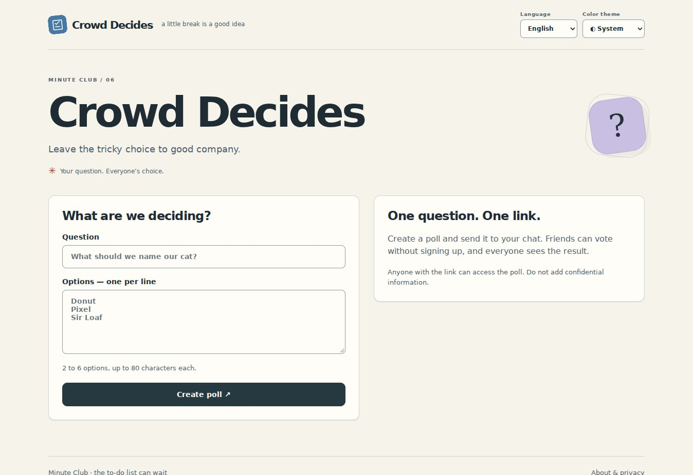

<div align="center">


# Crowd Decides

**Одна ссылка — общее решение.**

Создай короткий опрос и предложи друзьям решить вместе.

[English](README.md) · **Русский**

  

</div>

[Возможности](#возможности) · [Технологии](#технологии) · [Запуск](#запуск) · [Лицензия](LICENSE)



*Скриншот локального приложения с пустой тестовой базой; это не статистика аудитории.*

## Возможности

- Создатель может завершить голосование из того же браузера; результаты останутся доступны

- От двух до шести разных вариантов
- Ссылки с непредсказуемым идентификатором
- Общие результаты и история опросов в браузере

**Попробуй: Спроси → отправь ссылку → голосуйте → решите.**

Документация: English / Русский. Интерфейс приложения: English, Русский; выбор языка вручную или по настройкам браузера. По умолчанию тема системная; доступны ручные светлая и тёмная. Системный режим реагирует на смену темы устройства, выбор сохраняется локально.

## Технологии

| Слой | Реализация |
| --- | --- |
| Интерфейс | HTML · CSS · JavaScript / нативные ES-модули |
| Среда выполнения | Node.js 24+ · SQLite |
| Разработка | JavaScript |
| Зависимости | Без сторонних браузерных библиотек и внешних шрифтов |

## Запуск

Нужен **Node.js 24+**. Для запуска установка пакетов и сборка не требуются.

```sh
npm start
```

Открой http://localhost:3000. В корне работает это приложение; маршруты и API остальных приложений отключены. Данные сохраняются в `data/minute.sqlite`.

## Размещение

Задай `PUBLIC_ORIGIN` как точный HTTPS-origin, выдели постоянный `DATA_DIR` и поставь перед процессом HTTPS reverse proxy. В репозитории есть примеры Dockerfile, Caddy, переменных окружения и systemd. Каждому приложению нужны собственные порт и каталог данных. `.env` не читается автоматически: экспортируй переменные или запускай `node --env-file=.env server/index.mjs`. Резервные копии, модерация, ограничения идентификации и хранение описаны в [OPERATIONS.md](OPERATIONS.md) (англ.).

## Как это устроено

Участвовать может любой, у кого есть ссылка. История опросов хранится в браузере. Анонимный голос из браузера не подтверждает личность.

## Проверки

Нужен Node.js 24+.

```sh
npm test
npm run check
```


---

[Другие проекты den9911](https://github.com/den9911) · [Сообщить о проблеме](https://github.com/den9911/crowd-decides/issues) · [LICENSE](LICENSE)


## Recent improvements / Последние улучшения

Creators can open Create a similar poll to prepare an editable draft with only the title and options. Votes, closure and ownership secrets are not copied. A new poll is published only on explicit submission; the template endpoint checks the creator’s current session.

Создатель может подготовить похожий опрос: только заголовок и варианты, без голосов и закрытия. Новый опрос публикуется отдельным действием; права проверяются сервером по сессии.

Startup diagnostics / Проверка запуска: `node server/index.mjs --check` checks the local address, configuration and writable data location without creating a database or starting the API. To use another port: `--port 3005`. No tokens are printed. / База и сервер при проверке не создаются; секреты не выводятся.


## Session ownership — 14 November

The original signing key is preserved on restart. Empty, malformed or oversized key files now stop startup before SQLite opens. A missing key beside an existing database is not regenerated: restore the matching database/session-key backup. Creating a new key does not recover a lost browser cookie, and no endpoint grants ownership to a stranger. Explicit managed options.secret must remain identical on every start; automatic key rotation is not implemented.

Fresh initialization writes and syncs a private temporary key, then publishes it with a same-filesystem hard link without replacing an existing key. Concurrent initializers read the same complete key. Normal temporary files are cleaned. The data filesystem must support hard links; unsupported storage fails rather than silently changing identity. This is not a hardware power-loss or arbitrary-filesystem guarantee. Disk keys are exactly 64 lowercase hex bytes; managed secrets are bounded to 32–128 bytes. No secret values are logged. Backups contain sensitive signing material and must remain private.

При отсутствии или повреждении session-key восстановите исходный ключ из согласованной резервной копии. Удаление ключа не сбрасывает пароль и не возвращает потерянную cookie. Публичная информация об опросе не содержит owner secret. Сервер не восстанавливает права на основании ID опроса.
